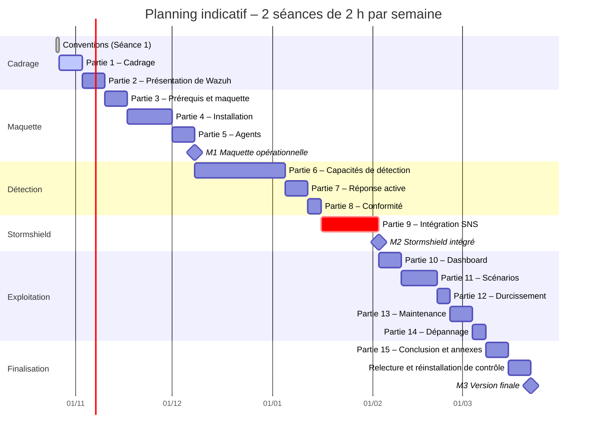

# Partie 1 – Cadrage

Cette partie pose le cadre du projet : le vocabulaire employé dans tout le document (1.1), le contexte et les objectifs (1.2), la place de Wazuh parmi les solutions du marché (1.3) et l'organisation du travail (1.4).

## 1.1 Page de garde, sommaire et glossaire

### 1.1.1 Page de garde, sommaire et organisation du dépôt

Le document est rendu en Markdown dans le dépôt GitHub `aminec58/wazuh-guide-fr`. Le fichier `README.md`, à la racine, sert de page de garde et de sommaire : c'est la page affichée à l'ouverture du dépôt. Le lecteur y trouve les versions de référence, l'architecture du labo, les conventions de lecture et un lien vers chaque partie, avec son état d'avancement.

Chaque partie est un fichier `docs/<numéro>-<nom>/README.md`, que GitHub affiche à l'ouverture de son dossier. Les fichiers réutilisables sont rangés à part, et le document les cite par leur chemin :

| Dossier | Contenu |
|---|---|
| `docs/` | Les 15 parties ; captures et schémas dans `docs/assets/` |
| `lab/` | Conventions du projet et maquette |
| `wazuh/` | Configuration déployable : règles, décodeurs, listes, politiques SCA, règles YARA, tableaux de bord |
| `integrations/` | Intégrations externes (Stormshield, VirusTotal, MISP, TheHive…) et échantillons de journaux |
| `tests/` | Tests `wazuh-logtest` et fiches de scénarios |
| `attack-simulation/` | Simulations d'attaques et matrice de couverture MITRE ATT&CK |
| `journal/` | Journal de bord : problèmes rencontrés, causes et solutions |

Les sections sont numérotées à la main dans les titres (1.1, 1.2…). Les renvois dans le texte utilisent ces numéros, par exemple « cf. 9.13 ».

### 1.1.2 Glossaire

Les termes sont classés par ordre alphabétique. Le numéro entre parenthèses renvoie à la partie qui traite le sujet en détail.

| Terme | Définition |
|---|---|
| **Active response** (réponse active) | Mécanisme de Wazuh qui exécute automatiquement un script (blocage d'une IP, désactivation d'un compte…) sur un agent ou sur le serveur quand une règle donnée se déclenche (7.1). |
| **Agent** | Logiciel installé sur une machine supervisée. Il collecte journaux, inventaire et état des fichiers, exécute certains contrôles localement et envoie le tout, chiffré, au manager, par défaut sur le port TCP 1514 (Partie 5). |
| **Agentless** | Supervision d'un équipement sans agent : réception de ses journaux en syslog, ou connexion SSH périodique pour vérifier son état (5.7). |
| **Alerte** | Événement qui a déclenché une règle d'un niveau suffisant. Elle est écrite dans `alerts.json` sur le serveur, puis indexée et consultable dans le dashboard. |
| **Analysisd** (`wazuh-analysisd`) | Démon du manager qui analyse chaque événement : pré-décodage, décodage puis évaluation des règles (2.3, 2.4). |
| **API REST** | Interface HTTPS du manager, sur le port 55000, qui permet de l'administrer par des requêtes : agents, règles, configuration… (10.6). |
| **Archives** | Copie de tous les événements reçus par le manager, qu'ils aient produit une alerte ou non (`archives.log`, `archives.json`). Désactivées par défaut, elles servent surtout au débogage (9.5). |
| **auditd** | Démon d'audit du noyau Linux : il journalise appels système, accès aux fichiers et commandes exécutées. Wazuh s'en sert notamment pour le who-data et la surveillance des commandes (6.3, 6.10). |
| **CDB** (liste) | *Constant DataBase* : liste clé/valeur compilée que les règles Wazuh consultent pour tester rapidement une valeur, par exemple une IP malveillante ou un compte autorisé (6.2, 6.13). |
| **CIS Benchmark** | Recommandations de configuration sécurisée publiées par le *Center for Internet Security*, par système et par logiciel. Base des politiques SCA de Wazuh (6.4). |
| **Corrélation** | Mise en relation de plusieurs événements (même source, même fenêtre de temps…) pour détecter un comportement qu'un événement isolé ne révèle pas : brute force, scan de ports… (6.2, 9.11). |
| **CTI** (*Cyber Threat Intelligence*) | Renseignement sur les menaces. Chez Wazuh, désigne aussi le service qui fournit les données de vulnérabilités au module de détection (6.5, 6.13). |
| **CVE** (*Common Vulnerabilities and Exposures*) | Identifiant public unique d'une vulnérabilité, au format `CVE-année-numéro` (6.5). |
| **CVSS** (*Common Vulnerability Scoring System*) | Score de 0 à 10 qui mesure la gravité d'une vulnérabilité (6.5). |
| **Dashboard** (Wazuh) | Interface web de Wazuh, dérivée d'OpenSearch Dashboards, accessible en HTTPS sur le port 443 (Partie 10). |
| **Décodeur** | Bloc XML qui reconnaît un format de journal et en extrait des champs (`srcip`, `dstport`, `user`, `action`…) pour que les règles puissent les tester (6.2, 9.7). |
| **DQL** (*Dashboards Query Language*) | Langage de requête du dashboard, utilisé pour filtrer les événements, par exemple `rule.level >= 10` (10.1). |
| **EDR** (*Endpoint Detection and Response*) | Outil de détection et de réponse sur les postes de travail et les serveurs. |
| **Enrôlement** | Enregistrement d'un agent auprès du manager, qui lui attribue un identifiant et une clé. Il passe par le démon `wazuh-authd`, sur le port TCP 1515 (5.3). |
| **EPS** (*Events Per Second*) | Nombre d'événements traités par seconde ; mesure courante de la charge d'un SIEM (13.4). |
| **EVA** (*Elastic Virtual Appliance*) | Version virtuelle du pare-feu Stormshield SNS, déployée sur un hyperviseur (Partie 9). |
| **Faux positif** | Alerte levée sur une activité légitime. On les réduit en ajustant les règles (13.5). |
| **Filebeat** | Agent de transfert installé sur le serveur Wazuh 4.x : il lit `alerts.json` (et `archives.json` si les archives sont activées) et envoie les données à l'indexer. Supprimé en Wazuh 5.0 (2.3). |
| **FIM** (*File Integrity Monitoring*) | Contrôle d'intégrité des fichiers : détection des créations, modifications et suppressions. Module `syscheck` de Wazuh (6.3). |
| **GPO** (*Group Policy Object*) | Stratégie de groupe Active Directory ; permet notamment de déployer l'agent Wazuh sur un parc Windows (5.2). |
| **IDS / IPS** | Système de détection (*Intrusion Detection System*, passif) ou de prévention (*Intrusion Prevention System*, bloquant) d'intrusions. Les alarmes du pare-feu SNS relèvent de cette fonction (Partie 9). |
| **Indexer** (Wazuh) | Moteur de stockage et de recherche, dérivé d'OpenSearch, qui indexe alertes et événements. API sur le port 9200, communication entre nœuds sur les ports 9300 à 9400 (2.3). |
| **IOC** (*Indicator of Compromise*) | Indice technique de compromission : empreinte de fichier, adresse IP, domaine, URL… (6.7, 6.13). |
| **ISM** (*Index State Management*) | Politiques de cycle de vie des index de l'indexer : rotation, passage en lecture seule, suppression après une durée donnée (13.1). |
| **Logcollector** | Module de l'agent (et du serveur) qui lit les fichiers journaux, journald et les journaux d'événements Windows (6.1). |
| **LTSB** (*Long-Term Support Branch*) | Branche de firmware Stormshield à support long, privilégiée pour la stabilité. |
| **Manager** (serveur Wazuh) | Composant central : il reçoit les données des agents et du syslog, les décode, applique les règles et produit les alertes (2.3). |
| **MITRE ATT&CK** | Base de connaissances des tactiques et techniques d'attaque, identifiées par un code, par exemple `T1110` pour le brute force. Les règles Wazuh y sont rattachées (6.14). |
| **Niveau de règle** (`rule.level`) | Gravité attribuée à une règle Wazuh, de 0 à 15 dans la classification officielle ; une règle de niveau 0 ne produit aucune alerte (6.2). |
| **NTP** (*Network Time Protocol*) | Protocole de synchronisation de l'heure. Indispensable pour comparer et corréler des journaux issus de machines différentes (3.3, 9.13). |
| **OpenSearch** | Moteur de recherche et d'analyse open source (licence Apache 2.0) dont dérivent l'indexer et le dashboard Wazuh. |
| **osquery** | Outil qui expose l'état d'un système sous forme de tables interrogeables en SQL ; intégrable à Wazuh (6.8). |
| **Pré-décodage** | Première étape d'analyse : Wazuh extrait l'en-tête syslog (date, nom d'hôte, programme) avant de transmettre la suite du message aux décodeurs (6.2). |
| **RBAC** (*Role-Based Access Control*) | Contrôle d'accès fondé sur des rôles, appliqué au dashboard et à l'API (10.5). |
| **Règle** | Bloc XML qui évalue les champs décodés d'un événement et décide s'il produit une alerte, avec quel niveau et quels groupes (6.2, 9.8). |
| **Remoted** (`wazuh-remoted`) | Démon du manager qui reçoit les données des agents (port 1514) et, si on le configure, les journaux syslog (port 514) (2.3, 9.5). |
| **RFC 3164 / RFC 5424** | Formats syslog : format « BSD » historique (RFC 3164) et format structuré moderne (RFC 5424). Le format choisi sur le SNS influe sur le pré-décodage (9.4, 9.13). |
| **SCA** (*Security Configuration Assessment*) | Module Wazuh qui vérifie la configuration d'un système à l'aide de politiques, CIS en particulier (6.4). |
| **Sibling decoders** (décodeurs frères) | Décodeurs enfants rattachés au même parent par `<parent>` et portant le même nom que lui ; chacun extrait un champ ou un petit groupe de champs. Ils décodent les journaux dont les champs varient d'un message à l'autre, comme les journaux clé=valeur du SNS (6.2, 9.7). |
| **SIEM** (*Security Information and Event Management*) | Solution qui centralise, normalise, corrèle et conserve les journaux de sécurité afin de détecter les incidents et d'enquêter dessus. |
| **SNS** (*Stormshield Network Security*) | Gamme de pare-feu et d'UTM de l'éditeur Stormshield (Partie 9). |
| **SOAR** (*Security Orchestration, Automation and Response*) | Plateforme qui automatise le traitement des incidents (enrichissement, tickets, réponse), par exemple Shuffle (7.4). |
| **SOC** (*Security Operations Center*) | Équipe ou centre chargé de la surveillance de la sécurité et de la réponse aux incidents. |
| **Syslog** | Protocole standard de transmission de journaux, en UDP ou TCP sur le port 514, ou en TLS (port 6514 en général) (5.7, 9.4). |
| **Sysmon** | Outil Microsoft Sysinternals qui journalise finement l'activité Windows : créations de processus, connexions réseau, modifications du registre… (6.9). |
| **Threat hunting** | Recherche proactive de menaces dans les données collectées, sans attendre qu'une alerte se déclenche (6.15). |
| **Tuning** | Ajustement des règles et des collectes pour réduire le bruit et les faux positifs (13.5). |
| **UTM** (*Unified Threat Management*) | Équipement qui regroupe pare-feu, prévention d'intrusion, filtrage web, VPN… C'est le cas du SNS. |
| **Vulnérabilité** | Faiblesse exploitable d'un logiciel ou d'une configuration. Wazuh détecte les vulnérabilités connues en comparant l'inventaire des paquets aux données CVE (6.5). |
| **Wazuh-logtest** | Outil du serveur qui affiche, pour une ligne de journal saisie, le résultat du pré-décodage, du décodage et la règle déclenchée. Outil central de mise au point (6.2, 9.9). |
| **Who-data** | Mode du FIM qui indique quel utilisateur et quel processus ont modifié un fichier ; il s'appuie sur auditd ou eBPF sous Linux et sur l'audit de Windows (6.3). |
| **WPK** (*Wazuh signed package*) | Paquet signé qui sert à mettre à jour un agent à distance depuis le manager (5.6). |
| **XDR** (*Extended Detection and Response*) | Détection et réponse étendues : corrélation de données issues de plusieurs couches (postes, réseau, cloud) et réponse coordonnée. |
| **YARA** | Langage de règles qui identifie des fichiers malveillants par motifs textuels ou binaires (6.7). |

## 1.2 Contexte, problématique, objectifs, périmètre et contraintes

### 1.2.1 Contexte

Tout système d'information produit des journaux en continu : authentifications, connexions réseau, modifications de fichiers, alertes du pare-feu. Pris isolément, ces journaux sont dispersés, hétérogènes et trop nombreux pour être lus. Un SIEM les centralise, les normalise et leur applique des règles de détection pour faire ressortir les événements qui demandent une action. Une solution XDR y ajoute la surveillance des postes eux-mêmes et des moyens de réponse.

Les grandes solutions commerciales (Splunk, QRadar…) sont puissantes mais coûteuses, et leurs versions gratuites sont bridées (1.3). Wazuh occupe une place à part : open source et sans limite de volume, il réunit dans un même produit un SIEM et un agent de sécurité complet (intégrité des fichiers, audit de configuration, détection de vulnérabilités, réponse active).

Ce projet est mené à titre personnel et suivi par un enseignant, qui a fixé deux exigences : une partie détaillée sur l'intégration d'un pare-feu Stormshield SNS, et un rendu en Markdown. Stormshield SNS est une gamme de pare-feu d'origine française. Ses journaux, au format clé=valeur, doivent être exploités au moyen de décodeurs et de règles écrits sur mesure, ce qui en fait un très bon cas d'étude de l'extensibilité de Wazuh.

> **À vérifier** — Absence de décodeurs Stormshield dans le jeu de règles fourni par défaut avec Wazuh 4.14 : à confirmer en 9.7, avant d'écrire les décodeurs personnalisés.

### 1.2.2 Problématique

**Comment déployer, configurer et exploiter Wazuh 4.14 pour superviser un parc hétérogène (Linux, Windows et pare-feu Stormshield SNS), et rendre exploitables les journaux du pare-feu (décodage, règles, corrélation, réponse), de façon entièrement reproductible par un lecteur qui découvre l'outil ?**

Cette question se décompose en quatre sous-questions, qui structurent le document :

1. Quelle architecture et quelle méthode d'installation retenir selon la taille du parc ? (Parties 2 à 4)
2. Comment collecter, décoder et analyser les événements des machines, avec ou sans agent ? (Parties 5 et 6)
3. Comment transformer les journaux bruts du SNS en alertes qualifiées et corrélées ? (Partie 9)
4. Comment répondre automatiquement aux menaces, démontrer la conformité et maintenir la plateforme dans la durée ? (Parties 7, 8 et 10 à 14)

### 1.2.3 Objectifs

| N° | Objectif | Indicateur de réussite |
|---|---|---|
| O1 | Documenter toutes les fonctionnalités de Wazuh 4.14 | Chaque fonctionnalité du plan suit la même structure (principe, configuration, paramètres, redémarrage, test, résultat attendu, pièges) et indique son niveau de profondeur (1.2.4) |
| O2 | Garantir la reproductibilité | Un lecteur reconstruit la maquette et obtient les mêmes alertes (`rule.id`, `rule.level`) en suivant uniquement le document |
| O3 | Intégrer complètement le SNS | Journaux reçus et archivés ; chaque type de journal retenu est décodé (champs vérifiés dans `wazuh-logtest`, tests consignés dans `tests/logtest/`) ; règles 100000 à 100199 (`wazuh/manager/rules/100000-stormshield.xml`) testées une à une |
| O4 | Démontrer la détection de bout en bout | Les 9 scénarios de la Partie 11 produisent l'alerte attendue, captures à l'appui ; résultats reportés dans `attack-simulation/mitre-coverage.md` |
| O5 | Rendre la plateforme exploitable dans la durée | Procédures de sauvegarde, de restauration, de mise à jour et de dépannage testées sur la maquette |
| O6 | Situer Wazuh et anticiper son évolution | Comparatif argumenté (1.3) ; différences de Wazuh 5.0 signalées dans chaque partie concernée |

### 1.2.4 Périmètre

**Dans le périmètre :**

- Wazuh **4.14.9** : toutes les fonctionnalités du plan. Installation tout-en-un sur la maquette ; architecture distribuée et haute disponibilité documentées, et déployées si les ressources le permettent.
- Agents Linux (Debian/Ubuntu, Rocky Linux) et Windows (Windows 11, Windows Server). macOS est documenté, et testé seulement si une machine est disponible.
- Stormshield SNS **4.8.20 LTSB** (EVA ou boîtier) : envoi syslog, réception, décodeurs, règles, tableaux de bord, corrélation et réponse active.
- Attaques simulées depuis Kali Linux, exclusivement contre les machines de la maquette.
- Comparaison avec cinq solutions concurrentes et signalement des évolutions de Wazuh 5.0.

**Hors périmètre :**

- Déploiement en production et traitement des données réelles d'une organisation.
- Mise en œuvre de Wazuh 5.0 : seules les différences avec la 4.14 sont signalées.
- Mesures de performance à grande échelle : le dimensionnement s'appuie sur les recommandations officielles, pas sur des tests de charge.
- Wazuh Cloud (offre SaaS) : présenté en 2.1, non déployé.
- Firmwares SNS v5 : mentionnés, non utilisés.

**Niveaux de profondeur.** Chaque fonctionnalité indique en tête son niveau :

| Niveau | Signification |
|---|---|
| **T** | Testée en labo, avec captures |
| **C** | Configurée, mais non déployée |
| **P** | Présentée avec une configuration type |

Le niveau visé par défaut est T. Les intégrations cloud (6.12) — AWS, Azure / Microsoft 365, Google Cloud et GitHub — sont documentées intégralement, mais restent au niveau C ou P si aucun compte gratuit ou d'essai ne permet de les tester.

### 1.2.5 Contraintes

| Type | Contrainte | Conséquence pour le projet |
|---|---|---|
| Versions | Wazuh 4.14.9 et SNS 4.8.20 LTSB figés (`lab/conventions.md`) | Aucune mise à jour pendant le projet ; dépôts désactivés après installation (4.7) |
| Format | Rendu en Markdown (GitHub Flavored Markdown), une partie par dossier `docs/<numéro>-<nom>/` | Schémas en Mermaid, captures dans `docs/assets/captures/`, renvois par numéro de section |
| Diffusion | Dépôt GitHub public ; licences MIT (code et configurations) et CC BY 4.0 (documentation) | Aucun secret versionné (`.gitignore`), journaux réels anonymisés, captures masquées avant chaque commit (risque R7) |
| Matériel | Une seule machine hôte pour toute la maquette | Machines virtuelles démarrées par groupes selon la séance (1.4.2, risque R2) |
| Licences | EVA activée par un kit téléchargé sur MyStormshield ; Windows en versions d'évaluation (90 jours pour Windows 11 Entreprise, 180 jours pour Windows Server 2025) | Accès à un SNS à sécuriser dès le début ; machines Windows créées le plus tard possible (risques R1 et R3) |
| Hyperviseur | Maquette sous VMware Workstation Pro, absent de la matrice officielle des EVA en version 4.8 (VMware ESXi 7.0 et 8.0, Citrix XenServer 7.6, KVM sous RHEL 8.4 et 9, Hyper-V sous Windows Server 2019 et 2022) | EVA hors support officiel : démarrage et activation testés dès la Partie 3, écart signalé en Partie 9 (risque R9) |
| Système | Windows 10 n'est plus supporté par Microsoft depuis le 14/10/2025 | Maquette sous Windows 11 ; écarts avec Windows 10 signalés au besoin |
| Temps | Projet personnel sans échéance imposée, séances de 2 h | Planning indicatif, réajusté à chaque jalon (1.4.1, risque R12) |
| Légal | Attaquer des systèmes sans autorisation est puni par les articles 323-1 et suivants du Code pénal | Réseau de maquette isolé, cibles exclusivement internes (risque R14) |
| Sources | Documentation officielle Wazuh 4.14 et Stormshield SNS 4.8 en priorité | Toute information non confirmée est marquée « À vérifier » |

## 1.3 Comparaison de Wazuh avec d'autres solutions

### 1.3.1 Critères de comparaison

- **Licence :** open source, *source-available* (code consultable mais licence restrictive) ou propriétaire.
- **Coût :** existence d'une version gratuite et ses limites ; modèle de l'offre payante.
- **Couverture :** SIEM (collecte, corrélation, alertes), sécurité des postes (intégrité des fichiers, audit de configuration, vulnérabilités), supervision du réseau.
- **Exploitation :** ressources nécessaires, complexité d'installation, communauté.
- **Adéquation au projet :** maquette personnelle, sans budget, avec intégration d'un pare-feu tiers.

Les informations de licence et de prix sont celles publiées par les éditeurs en octobre 2026 ; elles évoluent souvent.

### 1.3.2 Présentation des solutions

**Splunk.** Plateforme d'analyse de données machine, rachetée par Cisco en 2024, et référence historique du marché des SIEM. La fonction SIEM est fournie par l'application payante *Splunk Enterprise Security*. La licence gratuite *Splunk Free* permet d'indexer 500 Mo par jour, mais sur une instance unique, sans comptes utilisateurs ni authentification, et sans alertes : elle sert à apprendre, pas à surveiller.

**Elastic Security.** Fonctions de sécurité (SIEM et protection des postes avec Elastic Defend) de la pile Elastic : Elasticsearch, Kibana, Elastic Agent. Depuis fin août 2024, le code gratuit d'Elasticsearch et de Kibana est proposé sous licence AGPLv3, en plus de la SSPL et de l'Elastic License 2.0 (ELv2). L'offre se divise en un niveau gratuit et des abonnements payants (Enterprise ; Platinum n'est plus vendu aux nouveaux clients). Certaines fonctions, comme les règles d'alerte fondées sur la détection d'anomalies, sont réservées aux abonnements payants.

> **À vérifier** — Répartition exacte des fonctions d'Elastic Security entre le niveau gratuit et les abonnements : la matrice publiée par Elastic n'a pas pu être lue de façon fiable.

**Graylog.** Plateforme de gestion de journaux. *Graylog Open* est gratuit et sans limite de volume, distribué sous SSPL (*source-available*), mais se limite à des déclencheurs simples, sans moteur de corrélation ni authentification unique (SSO). Les éditions payantes sont facturées au volume traité : *Graylog Enterprise* à partir de 15 000 $ par an et *Graylog Security* (l'édition SIEM) à partir de 18 000 $ par an, pour 10 Go par jour en entrée de gamme.

**IBM QRadar.** SIEM historique d'IBM. En mai 2024, IBM a annoncé la cession de son offre cloud QRadar SaaS à Palo Alto Networks, effective en septembre 2024 ; les clients de QRadar on Cloud avaient jusqu'au 14/04/2026 pour migrer vers Cortex XSIAM. La version sur site reste maintenue par IBM. Une *Community Edition* gratuite existe : 100 événements par seconde, 5 000 flux réseau par minute, licence de 3 mois à renouveler, sans support, destinée à l'apprentissage et aux laboratoires.

**Security Onion.** Plateforme libre de supervision de la sécurité réseau (NSM), de gestion de journaux et de threat hunting, qui assemble notamment Suricata, Zeek et la pile Elastic. Ses propres composants et ceux d'Elastic sont distribués sous ELv2. La version 3.0.0 est sortie le 31/03/2026, et la branche 2.4 est en fin de vie depuis le 01/10/2026. L'édition payante *Security Onion Pro* ajoute notamment l'authentification OIDC, la conformité FIPS et STIG, Kafka et l'assistant Onion AI.

**Wazuh.** Plateforme open source de SIEM et de XDR, issue d'OSSEC (2.1). Le manager et les agents sont sous licence GPLv2 ; l'indexer et le dashboard dérivent d'OpenSearch (Apache 2.0). Toutes les fonctions sont gratuites et sans limite de volume ; le modèle économique repose sur l'offre Wazuh Cloud et sur le support (2.1). L'agent couvre nativement la collecte de journaux, l'intégrité des fichiers, l'audit de configuration (SCA), l'inventaire, la détection de vulnérabilités et la réponse active.

### 1.3.3 Tableau comparatif

| Solution | Licence | Version gratuite | Offre payante | Atouts | Limites |
|---|---|---|---|---|---|
| **Wazuh 4.14** | GPLv2 ; indexer et dashboard dérivés d'OpenSearch (Apache 2.0) | Complète, sans limite de volume | Wazuh Cloud, support | SIEM et XDR dans un seul produit ; agent complet (FIM, SCA, vulnérabilités, inventaire, réponse active) ; conformité intégrée | Règles et décodeurs XML exigeants ; recherche moins puissante que SPL ; refonte profonde annoncée en 5.0 |
| **Splunk** | Propriétaire (Cisco) | Splunk Free : 500 Mo/jour, instance unique, sans comptes ni alertes | Splunk Enterprise et Enterprise Security, sur devis | Langage de recherche SPL très puissant ; vaste écosystème d'applications | Coût élevé ; version gratuite inutilisable comme SIEM |
| **Elastic Security** | AGPLv3, SSPL ou ELv2 pour le code gratuit | Niveau gratuit de la pile Elastic | Abonnement Enterprise | Recherche rapide à grande échelle ; SIEM et protection des postes dans la même pile | Fonctions avancées payantes ; découpage gratuit / payant à vérifier |
| **Graylog** | SSPL pour Graylog Open | Graylog Open : sans limite de volume, sans corrélation ni SSO | Enterprise dès 15 000 $/an, Security dès 18 000 $/an (10 Go/jour) | Gestion de journaux simple à prendre en main | SIEM réservé aux éditions payantes ; pas d'agent de sécurité comparable à celui de Wazuh |
| **IBM QRadar** | Propriétaire | Community Edition : 100 EPS, 5 000 flux/min, licence de 3 mois renouvelable, usage non commercial | QRadar SIEM sur site ; offre SaaS cédée à Palo Alto Networks | Corrélation éprouvée ; analyse des flux réseau | Installation et exploitation lourdes ; offre recentrée sur le sur-site |
| **Security Onion 3** | ELv2 (composants Security Onion et Elastic) | Plateforme complète | Security Onion Pro, appliances, support | Supervision réseau (Suricata, Zeek) et threat hunting prêts à l'emploi | Orientée réseau ; très gourmande en ressources ; pas d'audit de configuration des postes |

### 1.3.4 Synthèse et justification du choix

Pour une maquette personnelle, sans budget, qui doit couvrir à la fois la surveillance des postes, la conformité et l'intégration d'un pare-feu tiers, **Wazuh est la seule solution qui réunit gratuité sans limite de volume, agent de sécurité complet et moteur de décodage extensible** :

- **Splunk Free et QRadar Community Edition** sont trop bridés pour servir de SIEM, même en laboratoire : pas d'alertes pour le premier, quotas et licence trimestrielle pour le second.
- **Graylog Open** se limite à des déclencheurs simples : la corrélation d'événements issus de sources différentes, au cœur de la 9.11, est réservée aux éditions payantes.
- **Elastic Security** est une alternative crédible, mais plus lourde à mettre en œuvre, et une partie de ses fonctions est payante.
- **Security Onion** répond à un autre besoin, la supervision du réseau. Il complète Wazuh plus qu'il ne le concurrence ; Wazuh sait d'ailleurs ingérer les alertes de Suricata.

Le choix de Wazuh s'accompagne de limites assumées : une recherche moins riche que celle de Splunk ou d'Elastic pour l'analyse ponctuelle, une syntaxe XML de règles à apprendre, et une version 5.0 qui refondra le moteur, les règles et la configuration. Les connaissances acquises sur la 4.14 devront donc être en partie réapprises ; c'est pourquoi chaque partie signale les différences de la 5.0.

## 1.4 Planning du projet, ressources et analyse des risques

### 1.4.1 Planning

**Hypothèses.** Le projet est personnel et n'a pas d'échéance imposée. Le travail est découpé en séances de 2 h, chacune avec un livrable unique, un commit Git et une entrée dans `CHANGELOG.md` en fin de séance. Chaque problème rencontré est consigné dans `journal/journal-de-bord.md`, qui alimente les Parties 14 et 15.1. Le calendrier ci-dessous suppose **2 séances par semaine à partir du 26/10/2026** ; il est indicatif et réajusté à chaque jalon.

| Lot | Contenu | Séances (2 h) | Livrable ou jalon |
|---|---|---|---|
| 0 – Cadrage | Conventions, Parties 1 et 2 | 5 | `lab/conventions.md`, `README.md`, Parties 1 et 2 |
| 1 – Maquette | Parties 3 à 5, dont le réseau de la maquette avec l'EVA SNS en passerelle | 8 | **M1** : maquette opérationnelle (serveur, agents, réseau) |
| 2 – Détection | Parties 6 à 8 | 11 | Parties 6 à 8 |
| 3 – Stormshield | Partie 9 | 5 | **M2** : SNS intégré (journaux décodés, règles testées) |
| 4 – Exploitation | Parties 10 à 14 | 9 | Parties 10 à 14 |
| 5 – Finalisation | Partie 15, relecture complète, réinstallation de contrôle | 4 | **M3** : version finale, reproductibilité vérifiée |
| **Total** | | **42 séances, soit environ 84 h** | |

**Lecture du diagramme :**

- Avec cette hypothèse, la version finale arrive autour du **22/03/2027**. Pour décaler tout le planning, il suffit de modifier la date de la première tâche : les suivantes s'enchaînent (`after`).
- La Partie 9 est marquée **critique** : c'est la partie exigée, et elle dépend de la maquette (Lot 1), des décodeurs et des règles (6.2) et de la réponse active (Partie 7).
- L'EVA SNS est déployée dès le Lot 1, car elle sert de passerelle entre le réseau interne et la zone de l'attaquant ; seule son intégration avec Wazuh attend le Lot 3.
- La réinstallation de contrôle du Lot 5 consiste à reconstruire une maquette vierge en suivant uniquement le document : c'est le test de l'objectif O2.

### 1.4.2 Ressources

**Ressources humaines.** Une personne (l'auteur), à raison de séances de 2 h ; suivi par un enseignant.

**Ressources matérielles.** Toute la maquette tourne sur une seule machine hôte. Dimensionnement prévu des machines virtuelles :

| Machine | Rôle | vCPU | RAM | Disque | Base du chiffre |
|---|---|---|---|---|---|
| `wazuh-server` | Serveur tout-en-un (Ubuntu Server 24.04) | 4 | 8 Go | 50 Go | Recommandation Wazuh pour 1 à 25 agents et 90 jours d'alertes |
| `deb-srv` | Agent Linux (Debian ou Ubuntu) | 1 | 2 Go | 20 Go | Estimation |
| `rocky-srv` | Agent Linux (Rocky Linux) | 1 | 2 Go | 20 Go | Estimation |
| `win-client` | Agent Windows 11 | 2 | 4 Go | 64 Go | Minimum Microsoft pour Windows 11 (TPM 2.0 virtuel requis) |
| `win-srv` | Agent Windows Server 2025, Active Directory | 2 | 4 Go | 60 Go | Estimation |
| `sns` | Pare-feu SNS (EVA1) | 1 | 2 Go | Image fournie | Notes de version SNS : 2 Go conseillés pour un EVA1 qui utilise le proxy |
| `kali` | Attaquant | 2 | 4 Go | 40 Go | Estimation |
| **Total** | | **13** | **26 Go** | **≈ 255 Go** | |

- Les valeurs « Estimation » sont des choix pour une maquette ; elles seront confirmées en Partie 3.
- Si toutes les machines tournent en même temps, il faut environ 26 Go de RAM pour les invités : un hôte de 32 Go est le minimum confortable. Sinon, on ne démarre que les machines utiles à la séance, par exemple `wazuh-server`, `sns` et `kali` (14 Go) pour la Partie 9.
- Disque : SSD conseillé, et environ 300 Go libres en comptant les snapshots.

**Ressources logicielles.**

| Logiciel | Version | Licence ou coût |
|---|---|---|
| Wazuh (serveur et agents) | 4.14.9 | GPLv2, gratuit |
| Ubuntu Server | 24.04 LTS | Gratuit |
| Debian ou Ubuntu, Rocky Linux | Version stable au jour de l'installation | Gratuits |
| Windows 11 Entreprise | Évaluation | Gratuit pendant 90 jours |
| Windows Server 2025 | Évaluation | Gratuit pendant 180 jours |
| Stormshield SNS (EVA) | 4.8.20 LTSB | Activation par un kit téléchargé sur MyStormshield ; aucun mode d'essai mentionné dans la documentation consultée |
| Kali Linux | Version du jour de l'installation (rolling) | Gratuit |
| VMware Workstation Pro (hyperviseur) | Version relevée à l'installation | Gratuit pour un usage personnel ; hors matrice officielle des EVA (1.2.5) |
| Rédaction | Éditeur Markdown, Git, dépôt GitHub public `aminec58/wazuh-guide-fr` | Gratuits |

> **À vérifier** — Conditions d'obtention d'une licence EVA pour un usage personnel ou de formation (évaluation, programme académique) : à demander à Stormshield ou à l'établissement de formation.

### 1.4.3 Analyse des risques

**Méthode.** Chaque risque reçoit une probabilité P et un impact I notés de 1 (faible) à 3 (élevé). La criticité vaut C = P × I. Un risque de criticité 6 ou plus est majeur et traité en priorité. Les risques sont revus à chaque jalon (M1, M2, M3).

| ID | Risque | P | I | C | Prévention ou réponse |
|---|---|---|---|---|---|
| R1 | Pas d'accès à un SNS activé (licence EVA ou boîtier) | 2 | 3 | 6 | Sécuriser l'accès dès le Lot 1 (établissement de formation, demande d'évaluation). À défaut, rejouer des journaux SNS réels anonymisés avec `logger` et `wazuh-logtest` : décodeurs et règles restent testables sans pare-feu |
| R2 | Ressources de l'hôte insuffisantes (≈ 26 Go de RAM si tout tourne) | 2 | 3 | 6 | Démarrer seulement les machines utiles à la séance ; réduire la RAM des agents Linux ; disque SSD |
| R3 | Expiration des évaluations Windows (90 jours pour Windows 11, 180 jours pour Windows Server) avant la fin du projet | 3 | 2 | 6 | Créer les machines Windows juste avant la Partie 5 ; garder un snapshot post-installation pour réinstaller vite. Une évaluation expirée de Windows 11 s'éteint toutes les heures |
| R4 | Sortie de Wazuh 5.0 en version stable pendant le projet | 3 | 2 | 6 | Gel en 4.14.9 maintenu ; encadrés « Différence Wazuh 5.0 » ; liens vers la documentation versionnée `/4.14/` |
| R5 | Mise à jour non maîtrisée des paquets (`apt upgrade`) | 2 | 3 | 6 | Dépôts désactivés après installation (4.7) ; contrôle des versions en début de séance |
| R6 | Perte ou corruption de la maquette | 2 | 3 | 6 | Snapshot avant chaque partie ; sauvegarde de la configuration (13.2) ; configurations et document versionnés sur GitHub |
| R7 | Fuite d'informations sensibles par le dépôt public (mot de passe, clé d'API, numéro de série, adresse réelle dans un fichier, un journal ou une capture) | 2 | 3 | 6 | Secrets exclus par `.gitignore` et remplacés par des `<MAJUSCULES>` dans le document ; journaux réels anonymisés (`integrations/stormshield/samples/README.md`) ; captures relues avant chaque commit. Secret publié par erreur : le révoquer ou le changer, car l'historique Git le conserve |
| R8 | Dérive du périmètre (« toutes les fonctionnalités ») | 3 | 2 | 6 | Plan figé ; structure commune à chaque fonctionnalité ; priorité aux Parties 4, 6, 9 et 11 ; idées hors plan notées en fin de partie |
| R9 | EVA sur VMware Workstation Pro, hyperviseur absent de la matrice officielle | 2 | 2 | 4 | Tester le démarrage et l'activation de l'EVA dès la Partie 3 ; documenter l'écart ; en cas d'échec, journaux rejoués (cf. R1) |
| R10 | Format des journaux SNS insuffisamment documenté | 2 | 2 | 4 | Travailler sur des journaux réels capturés (`tcpdump`, archives Wazuh) ; tests systématiques dans `wazuh-logtest` ; marqueur « À vérifier » |
| R11 | Horloges désynchronisées entre machines, faussant les corrélations | 2 | 2 | 4 | Même source NTP pour toutes les machines (3.3) ; vérification du fuseau horaire du SNS (9.13) |
| R12 | Disponibilité réduite (projet mené en parallèle des études) | 2 | 2 | 4 | Séances courtes à livrable unique ; planning réajusté à chaque jalon |
| R13 | Intégrations cloud nécessitant des comptes ou des offres payantes | 3 | 1 | 3 | Documentation complète ; tests avec des comptes gratuits ou d'essai ; sinon niveau C ou P (1.2.4) |
| R14 | Attaque simulée qui sort de la maquette | 1 | 3 | 3 | Réseau isolé, sans accès à Internet pendant les tests ; cibles exclusivement internes ; vérification des adresses avant chaque attaque |

Sur les huit risques majeurs (R1 à R8), cinq concernent la maquette (R1 à R3, R5 et R6) et sont traités dès le début du Lot 1. R7 se contrôle à chaque commit ; R4 et R8 sont revus à chaque jalon.

## Sources

- Wazuh — Quickstart, exigences matérielles et systèmes recommandés : https://documentation.wazuh.com/4.14/quickstart.html
- Wazuh — Release notes 4.14 : https://documentation.wazuh.com/4.14/release-notes/index.html
- Wazuh — Sibling decoders (4.14) : https://documentation.wazuh.com/4.14/user-manual/ruleset/decoders/sibling-decoders.html
- Splunk — About Splunk Free (Splunk Enterprise 10.4) : https://help.splunk.com/en/splunk-enterprise/administer/admin-manual/10.4/configure-splunk-licenses/about-splunk-free
- Elastic — Elastic Stack subscriptions : https://www.elastic.co/subscriptions
- Elastic — Ajout de la licence AGPL (Business Wire, août 2024) : https://www.businesswire.com/news/home/20240829537786/en
- Graylog — Pricing : https://graylog.org/pricing/
- Graylog — Open vs paid : https://graylog.org/open-vs-paid/
- IBM — QRadar Community Edition : https://ibm.com/community/101/qradar/ce
- TechTarget — IBM sells QRadar SaaS assets to Palo Alto Networks (16/05/2024) : https://www.techtarget.com/cybersecurity/news/366585436/IBM-sells-QRadar-SaaS-assets-to-Palo-Alto-Networks
- Secure ISS — QRadar to Cortex XSIAM migration options : https://www.secure-iss.com/newsroom/qradar-cortex-xsiam-migration-options
- Security Onion — Blog, avril 2026 (sortie de la 3.0.0, fin de vie de la 2.4) : https://blog.securityonion.net/2026/04
- Security Onion — License : https://docs.securityonion.net/en/3/main/license/
- Stormshield — Hyperviseurs supportés par les pare-feu virtuels : https://documentation.stormshield.eu/PLC/SNS/en/Content/SNS_Product_Life_Cycle/Matrices_virtual_firewall_hypervisors.htm
- Stormshield — Activation d'un pare-feu virtuel SNS EVA : https://documentation.stormshield.eu/SNS/v4/en/Content/Elastic_Virtual_Appliances_Installation_guide/Activating-Virtual-Image.htm
- Stormshield — Notes de version SNS v5 (mémoire conseillée pour l'EVA1) : https://documentation.stormshield.eu/SNS/v5/fr/Content/PDF/ReleaseNotesSNS/sns-fr-notes_de_version-v5.pdf
- Linuxiac — VMware Workstation Pro 17.6.2 Now Free for All Users (19/12/2024) : https://linuxiac.com/vmware-workstation-pro-is-now-free-for-all-users/
- Microsoft — Windows 11 Enterprise, évaluation : https://www.microsoft.com/en-us/evalcenter/evaluate-windows-11-enterprise
- Microsoft — Windows Server 2025, évaluation : https://info.microsoft.com/ww-landing-evaluate-windows-server-2025
